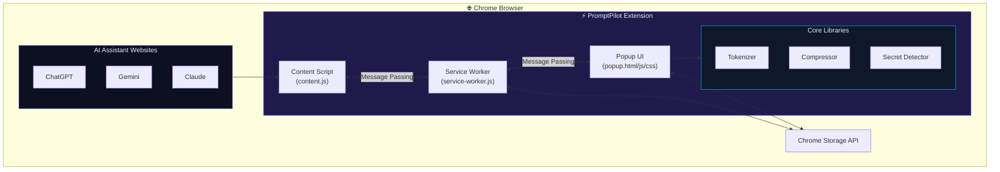

<div align="center">

# ⚡ PromptPilot

### AI Prompt & Context Optimizer

[](https://github.com/Nagasai22222/PromptPilot)
[](https://developer.chrome.com/docs/extensions/mv3/)
[](https://developer.mozilla.org/en-US/docs/Web/JavaScript)
[](LICENSE)

**Reduce unnecessary token consumption when working with AI assistants.**  
PromptPilot analyzes large prompts and accumulated conversation context, identifies redundant or outdated information, and produces a smaller but semantically useful context — saving you tokens and money.

[🚀 Install](#-installation) · [✨ Features](#-features) · [📖 How It Works](#-how-it-works) · [🛣️ Roadmap](#️-roadmap) · [🤝 Contributing](#-contributing)

</div>

---

## 🎯 The Problem

Every time you paste a long prompt or continue a deep conversation with an AI assistant, you're spending **tokens on redundant, verbose, and unnecessary content**:

- 🔁 Repeated instructions across messages  
- 💬 Filler phrases like *"I would really appreciate if you could..."*  
- 📋 Duplicate log entries pasted multiple times  
- 🔑 Accidentally exposed API keys and secrets  
- 📝 Verbose phrasing that could be simplified  

**PromptPilot solves this** by running your prompts through an intelligent multi-stage compression pipeline — right inside your browser.

---

## ✨ Features

<table>
<tr>
<td width="50%">

### 🔢 Real-Time Token Counter
Live token estimation as you type — know exactly how much context you're sending before hitting send.

### ✂️ Smart Compression Engine
Three compression modes to match your needs:
- 🛡️ **Conservative** — 10–30% reduction
- ⚖️ **Balanced** — 30–60% reduction  
- ⚡ **Aggressive** — 60–90% reduction

### 🔁 Duplicate Detection
Jaccard similarity-powered paragraph deduplication that finds and removes semantically repeated content.

</td>
<td width="50%">

### 🔒 Secret Redaction
Automatically detects and redacts API keys, tokens, passwords, and other sensitive data — **before** compression.

### 💻 Code Preservation
Your code blocks are sacred. PromptPilot extracts, protects, and restores them untouched through the entire pipeline.

### 📋 Log Compression
Collapses hundreds of repeated log lines into compact summaries like `[ERROR] Connection timeout (×47)`.

</td>
</tr>
</table>

### Additional Features

| Feature | Description |
|---------|-------------|
| 🌐 **AI Site Integration** | Works natively on **ChatGPT**, **Gemini**, and **Claude** |
| 📊 **Usage Statistics** | Track total optimizations, tokens saved, and average reduction |
| 🎛️ **Feature Toggles** | Enable/disable individual pipeline stages per optimization |
| 🔘 **Floating Action Button** | One-click capture from any supported AI chat |
| ⚙️ **Settings Page** | Configure defaults, backend URL, and view lifetime stats |
| 🎨 **Premium Dark UI** | Glassmorphism design with smooth animations |

---

## 🚀 Installation

### From Source (Developer Mode)

```bash
# 1. Clone the repository
git clone https://github.com/Nagasai22222/PromptPilot.git

# 2. Open Chrome Extensions page
#    Navigate to: chrome://extensions/

# 3. Enable Developer Mode (toggle in top-right corner)

# 4. Click "Load unpacked"

# 5. Select the `extension/` folder from the cloned repo

# 6. Done! The PromptPilot icon appears in your toolbar ⚡
```

> [!TIP]
> Pin the extension to your toolbar for quick access: Click the puzzle piece icon → Pin PromptPilot.

---

## 📖 How It Works

PromptPilot runs a **multi-stage compression pipeline** entirely in your browser:

```
  ┌──────────────────────────────────┐
  │   Your Large Prompt (8,000+ tokens)    │
  └──────────────┬───────────────────┘
                 ▼
  ┌──────────────────────────────────┐
  │  Stage 1: Secret Detection & Redaction │
  │  Stage 2: Code Block Protection        │
  │  Stage 3: Whitespace Normalization     │
  │  Stage 4: Filler Phrase Removal        │
  │  Stage 5: Verbose Language Simplify    │
  │  Stage 6: Duplicate Paragraph Detect   │
  │  Stage 7: Log Line Compression         │
  │  Stage 8: Aggressive Pruning (opt)     │
  │  Stage 9: Code Block Restoration       │
  └──────────────┬───────────────────┘
                 ▼
  ┌──────────────────────────────────┐
  │  Optimized Prompt (2,000–5,000 tokens) │
  └──────────────────────────────────┘
```

### Compression Modes Explained

| Mode | Reduction | What It Does |
|------|-----------|-------------|
| 🛡️ **Conservative** | 10–30% | Whitespace cleanup only. Safe for all content. |
| ⚖️ **Balanced** | 30–60% | Removes fillers, duplicates, verbose phrasing. Best for most use cases. |
| ⚡ **Aggressive** | 60–90% | Maximum reduction. Removes greetings, sign-offs, low-value content. |

---

## 📁 Project Structure

```
PromptPilot/
├── 📄 README.md                          # You are here
├── 📄 .gitignore                         # Git ignore rules
├── 📄 resize_icons.ps1                   # Icon generation utility
│
└── extension/                            # Chrome Extension (Manifest V3)
    ├── 📄 manifest.json                  # Extension configuration
    │
    ├── popup/                            # Main Extension Popup
    │   ├── 📄 popup.html                 # Popup UI structure
    │   ├── 📄 popup.css                  # Premium glassmorphism dark theme
    │   └── 📄 popup.js                   # UI controller & event handling
    │
    ├── content/                          # Content Scripts (injected into AI sites)
    │   └── 📄 content.js                 # DOM interaction, text extraction, FAB
    │
    ├── background/                       # Service Worker
    │   └── 📄 service-worker.js          # Event-driven background logic
    │
    ├── lib/                              # Core Libraries
    │   ├── 📄 tokenizer.js               # Client-side token estimation engine
    │   ├── 📄 compressor.js              # Multi-stage compression pipeline
    │   └── 📄 secret-detector.js         # API key / password / token redaction
    │
    ├── options/                          # Settings Page
    │   └── 📄 options.html               # Configuration & usage statistics
    │
    └── icons/                            # Extension Icons
        ├── 📄 icon16.png                 # Toolbar icon
        ├── 📄 icon48.png                 # Extensions page
        └── 📄 icon128.png               # Chrome Web Store
```

---

## 🏗️ Architecture



---

## ⚡ Tech Stack

| Layer | Technology |
|-------|-----------|
| **Extension** | JavaScript (ES Modules), Chrome Manifest V3 |
| **UI** | HTML5 + CSS3 (Glassmorphism dark theme, Inter font) |
| **Token Estimation** | Custom heuristic engine (→ js-tiktoken in Phase 2) |
| **Compression** | Multi-stage rule-based pipeline with Jaccard similarity |
| **Secret Detection** | Regex-based pattern matching for 10+ secret types |
| **Storage** | Chrome Storage API (local) |
| **Backend (Phase 2)** | Python + FastAPI |
| **Embeddings (Phase 3)** | Sentence Transformers + FAISS |

---

## 🛣️ Roadmap

| Phase | Description | Status |
|-------|-------------|--------|
| **Phase 1** | Chrome extension + client-side compression | ✅ Complete |
| **Phase 2** | Python FastAPI backend + LLM-powered compression | 🔜 Next |
| **Phase 3** | Embeddings, FAISS, conversation summarization | 📋 Planned |
| **Phase 4** | Local LLM support, benchmarking, project memory | 📋 Planned |

### What's Coming Next

- 🧠 **LLM-Powered Compression** — Use AI models to produce even smarter summaries
- 🔍 **Semantic Search** — FAISS-powered context retrieval from conversation history
- 📊 **Benchmarking Dashboard** — Compare compression quality across modes
- 🏠 **Local LLM Support** — Run compression models entirely offline

---

## 🔒 Privacy & Security

> [!IMPORTANT]
> **All processing happens entirely in your browser.** No data is ever sent to external servers.

- ✅ Zero network requests for compression
- ✅ Secrets are redacted **before** any processing
- ✅ No telemetry, analytics, or tracking
- ✅ Open source — audit the code yourself

---

## 🤝 Contributing

Contributions are welcome! Here's how to get started:

```bash
# Fork the repository
# Create your feature branch
git checkout -b feature/amazing-feature

# Make your changes
# Commit with a descriptive message
git commit -m "feat: add amazing feature"

# Push to your branch
git push origin feature/amazing-feature

# Open a Pull Request
```

### Development Setup

1. Clone the repo and load the `extension/` folder in Chrome (Developer Mode)
2. Make changes to files in `extension/`
3. Click the refresh button on `chrome://extensions/` to reload
4. Test your changes on [ChatGPT](https://chatgpt.com), [Gemini](https://gemini.google.com), or [Claude](https://claude.ai)

---

## 📜 License

This project is licensed under the **MIT License** — see the [LICENSE](LICENSE) file for details.

---

<div align="center">

**Built with ❤️ by [Naga Sai Srinivas Mudunuri](https://github.com/Nagasai22222)**

⭐ Star this repo if you find it useful!

</div>
